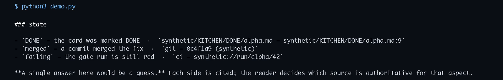
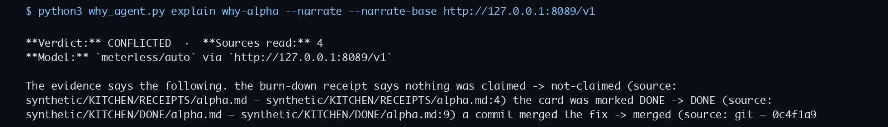

# why-agent — slide deck

**Open Agent Hackathon 2026 · Track 02: The Agent That Can Explain Why**
Mission Winning · `github.com/Snedz/why-agent`

Twelve slides. Every number in here is measured, and every claim is cited in the
repository.

---

## 1. The problem

**"Why did this happen?" is answered in five places that never talk to each other.**

The card says `DONE`. The commit says `merged`. The check run says `red`. The
receipt says nothing was claimed. The review says `approved` — for a different
card.

A person resolves this by opening five files and holding five facts in their
head. **An agent that reads one source sounds confident and is wrong more often
than not** — worse than no answer, because nobody checks a confident answer.

**Who it is for.** The person who has to answer "why did this happen?" from
someone else's evidence: a tech lead after an incident, a reviewer deciding
whether to trust a status report, an auditor reconciling a decision from
receipts. None of them asked for a summary. They are asking **which of the
five sources to believe** — and that is not a question a summary answers.

---

## 2. The idea

**Read all the sources. Then say what they collectively do not agree on.**

Not "generate an explanation". **Reconcile claims.** Every source makes a claim
about a property of the item. Two claims about the same property with different
values contradict each other. Two claims about different properties never do.

The interesting case is the contradiction — and it is exactly the case a
reader cannot resolve by eye, because it lives in five different places.

---

## 3. What it does

| Verdict | When | What it does |
|---|---|---|
| `CORROBORATED` | the sources agree and cover the ground | says so, cited line by line |
| `PARTIAL` | they agree where they speak, and do not cover everything | says what is corroborated, **names the gaps** |
| `CONFLICTED` | two sources disagree about the same thing | **shows every side, cites every side, refuses to pick** |
| `NO EVIDENCE` | nobody has written anything | says exactly that |

**UNKNOWN is never 0.** An aspect nobody reported is a gap in the evidence, and
it is reported as a gap — not as a pass, and not as a plausible explanation.

---

## 4. It is code, not a prompt

The reconciliation is a Python function with tests that assert its behaviour:

- a card that disagrees with a commit is a **conflict**, not a merge;
- two sources about *different* aspects never conflict;
- an aspect nobody covered is **UNKNOWN**, not a pass;
- **every claim in the report carries a citation**;
- an item nobody wrote about gets `NO EVIDENCE`, not a plausible explanation.

**27 tests. Offline. No third-party dependency.** A prompt cannot be tested
like that. This can, and is.

---

## 5. The demo — five cases, one command

```
$ python3 demo.py
```

| Case | Shows |
|---|---|
| `why-alpha` | four sources, four answers — **no winner picked** |
| `why-beta` | two aspects corroborated, **one gap named** |
| `why-delta` | the easy case — and it is still cited line by line |
| `why-gamma` | one lonely source, two gaps |
| `why-nothing` | nobody wrote anything — **NO EVIDENCE**, not a guess |



---

## 6. The model may write the prose. It may not add a fact.

The reconciliation is code and decides what is true. The prose is written by a
model over an OpenAI-compatible endpoint — and then **checked**: every value
the narrative states must already exist in the evidence.

**Two passes, because a model may forget to quote.** Quoted spans, *and* every
token that looks like a value — an identifier, a number, a path, a date.
Prose words are not values and are not checked: this is not a semantic
verifier, and pretending otherwise would make the check useless.

```
$ why_agent.py explain why-alpha --narrate
## CHECK PASSED — every value the narrative stated exists in the evidence
```

When a model invents a fact, the check fails, the invented value is **listed**,
and the report says the narrative was not cleaned up. It is reported, not
silently removed — because a silent cleanup is how a hallucination becomes a
footnote.



---

## 7. The agent's workflow

| Stage | What happens | Who decides |
|---|---|---|
| **Ingest** | every source's claims are read into one table — `item_id, kind, source, locator, statement, value, observed_at, aspect` | code |
| **Reconcile** | claims are grouped by `aspect`; two different values for one aspect are a conflict, and an aspect nobody reported is `UNKNOWN` | code |
| **Report** | a Markdown answer in which **every line carries its citation** | code |
| **Narrate** | a model writes the prose over the reconciled facts — optional | the model, and then **it is checked** |

```
$ why_agent.py explain why-alpha
## Verdict: CONFLICTED — four sources, four answers, no winner picked
```

**No prompt decides what is true.** The reconciliation is upstream and
deterministic; the model is downstream of it and is checked against it. It can
write the prose. It cannot add a fact.

---

## 8. Zetaris — the evidence layer

Zetaris is a data harness for AI: a governed semantic layer over DuckDB,
Spark, Trino and Presto. Data reaches it as a filestore table (CSV in the
stack bucket, then a reconciliation `SELECT`). There is no MCP endpoint on
that path.

That is the shape of this problem. The evidence is fragmented by nature, and
the question is what the five sources *together* say.

| Here | In a Zetaris harness |
|---|---|
| the `evidence` table | a table definition |
| the `aspect` vocabulary | **the semantic layer the agent queries by** |
| the check that every stated value exists | a query-time constraint |

**What is unique about this use.** Zetaris was not bolted on afterwards. The
`aspect` vocabulary — `state`, `outcome`, `cause` — is already the interface
the agent queries by, and "every value the narrative states must exist in the
evidence" is already a constraint over that vocabulary. The harness would not
be a new layer *over* the agent; it is the agent's own vocabulary, made
governed.

**Runs today with no account** (JSONL, or the same DuckDB file). The harness is
a governance upgrade, not a dependency for correctness.

---

## 9. Meterless — the runtime and the meter

Meterless (Nightshift) is **Apache-2.0 and open source**: it races a job across
local models, judges the attempts, and returns **a receipt for every check**.

- **As the runtime** — the agent's model calls go to the local
  OpenAI-compatible endpoint (`meterless/auto`, `meterless-app: why-agent`,
  the vendor's 180 s timeout). On this M1 the API listened on `[::1]:8088`.
  `GET /v1/models` returned 200. `explain why-alpha --narrate` returned
  HTTP 502. CHECK PASSED was not observed.
- **As the meter** — the agent's own calls are metered under one app id, with
  a receipt, in the same ledger where the rest of the work is metered.

**What is unique about this use.** Meterless is both halves of one job, not
one of them. The runtime that writes the prose is the same system that keeps
the receipt for it, under one app id — so the cost of an explanation is
visible next to the work it explains, instead of in a separate billing system
somewhere else.

**The runtime is optional**: the deterministic report is the part that decides
what is true, and the demo does not need a model.

---

## 10. What it is built on

- **Python, standard library only.** No dependency, no install, no account.
- **The evidence file is JSON Lines** — meant to be read with `cat`. A demo
  has to be legible.
- **Every claim is a row**: `item_id, kind, source, locator, statement, value,
  observed_at, aspect`. A citation is a field, not a convention.
- **Synthetic data only** in this repository: no real card, customer or
  identifier.
- **Apache-2.0.** We keep all rights.

---

## 11. What is next

- **A real Zetaris harness.** The evidence layer is the same rows and the same
  queries; what is missing is the account, not the design.
- **A narration that completes.** The M1 runtime answered `/v1/models` and
  then returned HTTP 502 for the why-alpha prompt (`model_load_failed`).
- **More aspects.** `state`, `outcome` and `cause` are the vocabulary today.
  The aspect is a column, so a new one is a new column — not a new engine.
- **A Colab notebook** over the same agent, so a judge can run it without
  installing anything.
- **A real DuckDB file.** The production read path is code and is covered by
  the tests; the file it reads is synthetic and stays out of the repository.

---

## 12. The ask

- **Track 02 — The Agent That Can Explain Why.** First prize $1,600.
- **Repo:** `github.com/Snedz/why-agent` · **Demo:** 1–4 minutes ·
  **Deck:** this file.
- **Pre-existing components declared** (rule 04): the receipt-and-verdict
  discipline, the card/commit/receipt vocabulary, the model-verdict ledger.
  **The entry — the agent, the reconciliation, the check — was built inside
  the window.**
- **Mission Winning.** Brand identity only.

> The one thing to take away: **an agent that cannot say "the sources
> disagree" is not explaining anything.** It is guessing, confidently, and
> the confidence is the part that costs you.
